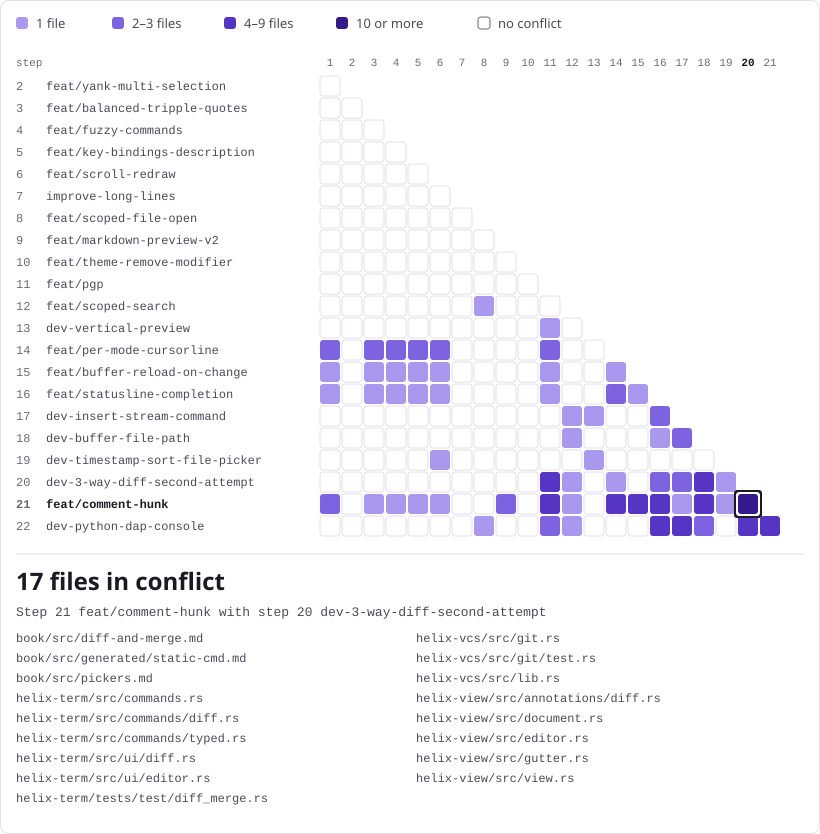

<!-- Generated by python3 docs/merge-map/generate.py from data.json. -->
# main-kuba

The feature branches in this fork and the recommended path to rebuild them
on a fresh `main` branch. The plan combines **22 branch merges** with folding
and a final regression-test cherry-pick.

[Rebuild path](#rebuild-path) · [Conflict map](#conflict-map) ·
[Features and merge order](#features-and-merge-order) · [Build](#build)

## Rebuild path

Follow these phases in order:

| Phase | Steps | What to expect |
| --- | --- | --- |
| Clean merges | 1–11 | Configuration, editing, performance, previews, themes, and encryption. |
| Small conflicts | 12–16 | Search, picker layout, cursorline, reload, and completion; 1–3 files per step. |
| Larger features | 17–22 | Streaming, paths, sorting, diff/merge, reviews, and debugger; 1–32 files per step. |
| Finish | 23–24 | Apply folding and optionally retain the spinner regression test. |

The step numbers are shared by the feature list and conflict map.

## Conflict map

Rows are merge steps; column numbers refer to earlier steps. The purple
scale shows how many files conflicted in each pair. The selected pair is
step 21 (`feat/comment-hunk`) against step 20 (three-way diff).

<picture>
  <source media="(prefers-color-scheme: dark)" srcset="docs/merge-map/map-dark.svg">
  
</picture>

## Features and merge order

Merge one branch at a time in this order.
Resolve and check each step before moving to the next.

| Step | Feature | Branch or cherry-pick | Distinct conflicting files |
| --- | --- | --- | --- |
| 1 | Recoverable configuration with visible startup and reload warnings. | `feat/recoverable-config` | 0 (clean) |
| 2 | Paste surplus yanked selections on new lines instead of losing entries. | `feat/yank-multi-selection` | 0 (clean) |
| 3 | Automatically pair triple quotes and backticks. | `feat/balanced-tripple-quotes` | 0 (clean) |
| 4 | Find command completions despite typos. | `feat/fuzzy-commands` | 0 (clean) |
| 5 | Describe key bindings with comments in the configuration. | `feat/key-bindings-description` | 0 (clean) |
| 6 | Synchronized redraws and smoother scrolling. | `feat/scroll-redraw` | 0 (clean) |
| 7 | Responsive navigation on long, soft-wrapped lines. | `improve-long-lines` | 0 (clean) |
| 8 | Open nearby files and jump or peek at path:line:column locations. | `feat/scoped-file-open` | 0 (clean) |
| 9 | Preview Markdown inside the editor, fullscreen or in a split. | `feat/markdown-preview-v2` | 0 (clean) |
| 10 | Remove inherited theme modifiers with a leading minus. | `feat/theme-remove-modifier` | 0 (clean) |
| 11 | Edit passphrase-encrypted OpenPGP files. | `feat/pgp` | 0 (clean) |
| 12 | Search the current file first, then nearby directories before the rest of the workspace. | `feat/scoped-search` | 1 |
| 13 | Keep picker previews beside the list on wide screens. | `dev-vertical-preview` | 1 |
| 14 | Use different cursorline styles in normal, insert, and select modes. | `feat/per-mode-cursorline` | 3 |
| 15 | Reload files changed on disk, including while the editor is idle. | `feat/buffer-reload-on-change` | 1 |
| 16 | Show completion suggestions in the statusline with keyboard and mouse selection. | `feat/statusline-completion` | 2 |
| 17 | Stream shell-command output into buffers, with queuing and cancellation. | `dev-insert-stream-command` | 4 |
| 18 | Display and copy buffer paths and path:line locations. | `dev-buffer-file-path` | 3 |
| 19 | Sort file-picker matches by modification time. | `dev-timestamp-sort-file-picker` | 1 |
| 20 | Compare working files, commits, and bases; resolve three-way merges. | `dev-3-way-diff-second-attempt` | 15 |
| 21 | Attach inline review discussions and coding-agent conversations to diff hunks. | `feat/comment-hunk` | 32 |
| 22 | Debug Python with an interactive console and improved debugger panes. | `dev-python-dap-console` | 12 |
| 23 | Folding fitted to the combined features. | `git cherry-pick 452a37af1 2db61bd42` | Not measured in the pairwise map |
| 24 | Optional spinner regression test. | `git cherry-pick 98206ee63` | Not measured in the pairwise map |

Counts are distinct files across a step's earlier conflicting pairs, not the
sum of its cells. Steps 23 and 24 are cherry-picks and have no matrix rows.

## Build

The `pgp` feature requires Rust 1.88 or newer.

```sh
HELIX_DISABLE_AUTO_GRAMMAR_BUILD=1 cargo build --release --features pgp
```
